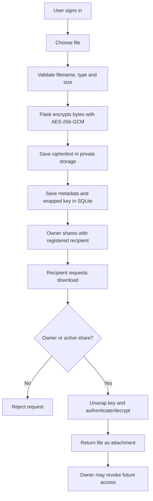
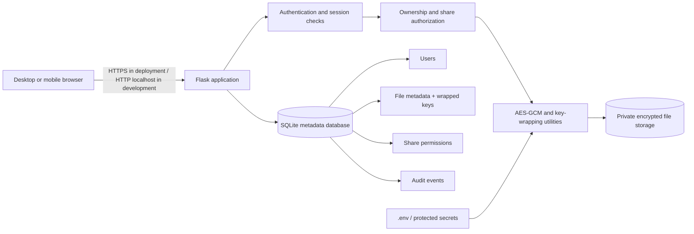

  
  <h1>RagaShare</h1>
  
<strong>Secure File Sharing System Using Private-Key Cryptography</strong>

  
Encrypt files. Share with named users. Verify every download.

  

    
    
    
    
  

  

    <a href="#quick-start">Quick Start</a> ·
    <a href="#animated-workflow">Animated Workflow</a> ·
    <a href="#security-model">Security Model</a> ·
    <a href="#run-tests">Tests</a> ·
    <a href="#install-on-a-device">Install App</a>
  

  

    <strong>Created by Ganesh M</strong> ·
    <a href="https://github.com/Ganu0124">GitHub Profile</a>
  

What is RagaShare?
RagaShare is an educational file-sharing web application and Progressive Web App (PWA). It gives each registered user a private file library, encrypts uploads with AES-256-GCM, and lets an owner grant or revoke application access for another registered user.
The application uses Flask for web requests, SQLAlchemy for relational metadata, SQLite for local development, and private filesystem storage for encrypted file objects. One codebase serves desktop and mobile browsers.
Security clarity: this repository's current implementation uses server-managed encryption. Flask receives file bytes, encrypts them before storage, then decrypts files for authorized downloads. The server therefore has access to plaintext during those operations. This is encrypted storage, not end-to-end encryption. The separate Web Crypto API + AWS S3 graphic in the project materials is a reference architecture, not proof of an existing S3 integration.

Table of Contents
- Key Features
- Screenshots
- Animated Workflow
- System Architecture
- File Lifecycle, Step by Step
- Five-Phase Project Workflow
- Technology Stack
- Quick Start
- Environment Configuration
- Run the Application
- Demonstrate File Sharing
- Run Tests
- Install on a Laptop or Phone
- Project Structure
- Routes at a Glance
- Security Model and Limitations
- Troubleshooting
- GitHub Setup
- Documentation and References
- Project Author and Contact
Project Author and Contact
RagaShare is developed as a Web Application Security project. Update the LinkedIn and email fields below with your preferred public contact details before publishing the repository.
Detail	Information
Author	Ganesh M
Programme	MCA, Artificial Intelligence & Data Science
Institution	Amrita Vishwa Vidyapeetham, Mysuru Campus
GitHub	Ganu0124
LinkedIn	Add your LinkedIn profile URL here
Email	Add your public contact email here
Project	RagaShare, Secure File Sharing System Using Private-Key Cryptography
Academic year	2026–2027

Before making the repository public, replace the LinkedIn and email placeholders with contact details you are comfortable sharing publicly. Do not publish a private or institution-only email without checking its intended use.

Key Features
Area	What it does
Accounts	Register, sign in, sign out, and update display name
File encryption	AES-256-GCM with a random 256-bit key and a 96-bit nonce per file
Key protection	Wraps each file key with a separate environment-configured master secret
File library	Search by filename, filter by allowed type, sort by name/date/size, view details, download, delete
Sharing	Grant access to a registered account by email; revoke future application access
Authorization	Checks ownership or an active share before returning a protected file
Activity	Records selected account and file events without storing file contents or encryption keys in audit messages
PWA	Manifest, icons, service worker, and an offline fallback screen
Web safeguards	CSRF protection, security headers, upload validation, size limit, and rate limits
Device support	Responsive layout for laptop, desktop, tablet, and supported mobile browsers

Current upload allowlist: PDF, TXT, PNG, JPG/JPEG, DOCX, XLSX, CSV. The default maximum upload size is 10 MB.
Screenshots
Important: GitHub renders images only when the image files are also committed to the repository. Keep the assets folder beside this README.md. Do not upload the README alone. Preserve the filenames and capitalization shown below.
Workspace overview

My Files

Upload interface

Shared With Me

Install app

Reference browser-encryption architecture

These are supplied project screenshots and reference material. They document visible design states. They do not independently prove cryptographic correctness or successful security testing.
Animated Workflow
The following GIF animates the eight main stages of the server-managed file-sharing workflow. GitHub supports animated GIFs in repository Markdown. Keep the GIF at the path shown below.

If the animation does not appear, open assets/ragashare-workflow.gif in the repository to confirm it was uploaded. Then check the filename's exact capitalization and spelling.
Workflow diagram (static fallback)

System Architecture

Key components
- Browser UI: HTML templates, Bootstrap, CSS, JavaScript, and responsive navigation.
- Flask control layer: validates requests, manages sessions, enforces authorization, and serves the pages.
- Cryptographic module: encrypts and decrypts file bytes and wraps/unwraps per-file AES keys.
- SQLite: stores user accounts, file metadata, sharing permissions, and selected audit events.
- Private storage directory: stores .enc ciphertext objects outside the public static/ directory.
- PWA layer: uses the app manifest and service worker for supported install flows and a restricted safe shell cache.
File Lifecycle, Step by Step
1. Register and authenticate
A user creates an account with a unique email. The application stores a password hash, not the plaintext password. Login establishes a session, and private routes require an authenticated session.
2. Choose and validate a file
The user opens Upload and chooses a supported file. The server validates the name, extension, request size, and presence of file bytes. It uses a generated internal ID for storage instead of trusting the supplied filename as a path.
3. Encrypt the file
The server generates a random 256-bit AES key and a fresh 12-byte (96-bit) nonce for the file. AES-GCM outputs ciphertext with an authentication tag. Altered ciphertext or a wrong key causes authenticated decryption to fail.
4. Protect the file key
The application wraps the per-file AES key using a separate master secret configured as AES_KEY_WRAP_SECRET. The wrapped key and nonce are stored as metadata. The master secret stays outside the source repository in .env or a protected deployment secret store.
5. Store ciphertext and metadata
The encrypted object goes into storage/. The SQLite record contains the owner ID, original download name, generated storage name, nonce, wrapped file key, size, and timestamp. The original plaintext is not written to the storage object.
6. Share with a recipient
The owner submits the email of another registered RagaShare user. The backend verifies ownership, locates the recipient account, and records an active share permission. A file ID alone does not grant access.
7. Authorize every download
When the recipient requests a download, the backend checks the current database state. Access is allowed only to the owner or a recipient with an active share. Unrelated users receive a denial even if they know the file ID.
8. Decrypt and download
After authorization succeeds, the application reads ciphertext, unwraps the file key, authenticates and decrypts the bytes, and returns the original file as an attachment. Decryption failure does not produce a successful plaintext response.
9. Revoke access
The owner marks the share inactive. The next download request checks the updated permission and should be denied. Revocation does not delete a recipient's earlier downloaded copy.
Five-Phase Project Workflow
Phase	Objective	Deliverable / verification evidence
1. Foundation	Inspect project structure, configure Flask, database, registration, sessions, templates	App routes work; authentication checks and database initialization
2. File management	Dashboard, file library, upload page, search/filter/sort, file details	Dashboard reflects database values; file actions use real routes
3. Cryptographic core	AES-GCM, key wrapping, encrypted storage, share authorization, revocation	Crypto round-trip/tampering and owner-recipient-unrelated-user tests
4. Mobile and PWA	Responsive layout, manifest, icons, service worker, install guidance	Browser checks across viewports and PWA checks on supported browsers
5. Verification and delivery	Tests, threat model, README, run instructions, deployment notes	Actual test output, reproducible steps, documented limitations

A phase should be marked complete after its behavior has been tested, not only after its source files have been created.
Technology Stack
- Python 3.10+: backend language.
- Flask: routes, request validation, templates, and HTTP responses.
- Flask-Login: login session integration.
- Flask-SQLAlchemy / SQLite: relational metadata and local persistence.
- Flask-WTF CSRF protection: protects state-changing form submissions.
- Flask-Limiter: request rate limits.
- cryptography: AES-GCM and cryptographic key operations.
- Werkzeug: password hashing and safe filename utilities.
- Bootstrap 5 + custom CSS/JavaScript: responsive interface.
- PWA manifest + service worker: installation and safe shell caching.
- pytest: unit and integration test framework.
Quick Start
Prerequisites
- Python 3.10 or newer installed and available as python in PowerShell.
- Git, if you plan to publish the project.
- A current browser.
- Internet access at first launch if the Bootstrap and font CDNs are used by the interface.
Windows PowerShell
1. Download or clone the repository.
2. Open PowerShell in the repository root, the folder containing app.py and requirements.txt.
3. Create and activate a virtual environment.
python -m venv .venv
.\.venv\Scripts\Activate.ps1
python -m pip install --upgrade pip
pip install -r requirements.txt
If PowerShell blocks the activation script, use this command for the current terminal only, then activate the environment again:
Set-ExecutionPolicy -Scope Process -ExecutionPolicy Bypass
.\.venv\Scripts\Activate.ps1
Create the environment file
Copy the supplied template:
Copy-Item .env.example .env
notepad .env
Generate the Flask session secret:
python -c "import secrets; print(secrets.token_urlsafe(48))"
Generate a separate, random 32-byte AES key-wrapping secret in URL-safe Base64:
python -c "import base64,secrets; print(base64.urlsafe_b64encode(secrets.token_bytes(32)).decode())"
Paste the first result into FLASK_SECRET_KEY and the second into AES_KEY_WRAP_SECRET in .env. Keep the two values different. Save the file.
Example format only, not usable secrets:
FLASK_SECRET_KEY=your_generated_session_secret
AES_KEY_WRAP_SECRET=your_generated_base64_key
DATABASE_URL=
STORAGE_DIR=
COOKIE_SECURE=false
Do not paste real secrets into GitHub issues, screenshots, README files, or source code. The master key is needed to recover stored files. Losing it can make the existing encrypted files unrecoverable.
Run the Application
From the activated environment and repository root:
python app.py
Open the local URL:
http://127.0.0.1:5000
Keep the terminal open while using the app. Stop the server with Ctrl+C.
If you see Could not open requirements file, the terminal is not in the directory containing requirements.txt. Run:
Get-ChildItem -Recurse -Filter requirements.txt
Then cd into the folder reported by the command. Do not type the .txt path by itself as if it were a command.
If port 5000 is already in use, stop the other Flask process before starting RagaShare. Do not expose Flask's built-in development server directly to the public internet.
Demonstrate File Sharing
Use two separate browser profiles or one normal and one private browser window.
1. Register User A and sign in.
2. Register User B in the separate browser profile.
3. As User A, upload a small .txt or .pdf file.
4. Open the uploaded file's details page.
5. Enter User B's registered email and grant access.
6. Sign out from User A and sign in as User B.
7. Open Shared With Me and download the file.
8. Compare the downloaded file with the original. The bytes should match.
9. Sign back in as User A and revoke the share from file details.
10. Sign in as User B and try the same download URL again. The new request should be denied.
11. For a stronger access-control demonstration, register User C and verify that User C cannot download the file at all.
This walkthrough demonstrates application authorization. It does not revoke or erase copies already downloaded by a recipient.
Run Tests
Install dependencies using requirements.txt, activate the project environment, then run:
python -m pytest
For detailed output:
python -m pytest -v
The tests use temporary databases and temporary file storage where configured. Record the actual command output when reporting results. Do not state that the suite passed unless it was executed successfully in your environment.
Core test areas
- Authentication and password hashing.
- AES-GCM round trip, wrong-key rejection, and ciphertext tampering.
- Upload validation.
- Owner and recipient downloads.
- Unauthorized download denial.
- Revocation behavior.
- PWA manifest and service-worker endpoint availability.
- Selected security response headers.
Install on a Device
RagaShare is a PWA. Installation support depends on browser, operating system, and secure-origin conditions.
Windows / desktop
1. Deploy RagaShare to an HTTPS origin, or use localhost for development.
2. Open it in a supported Chrome or Edge browser.
3. Use the browser's Install app option when available.
4. Launch RagaShare from the installed app shortcut.
Android
1. Open the HTTPS site in a supported browser.
2. Open the browser menu.
3. Choose Install app or Add to Home screen.
4. Confirm the prompt.
iPhone / iPad
1. Open the HTTPS site in Safari.
2. Tap Share.
3. Select Add to Home Screen.
4. Confirm the shortcut.
The local URL 127.0.0.1 points to the device running the browser. A phone's 127.0.0.1 points to the phone itself, not your laptop. To use RagaShare on a phone, deploy to HTTPS or configure a controlled local-network test environment. Never expose the Flask development server to the public internet.
The service worker caches only a small static shell and the offline fallback. It should not cache authentication responses, private pages, downloads, plaintext files, or encryption keys.
Project Structure
RagaShare/
├── app.py                         # Flask application factory and routes
├── config.py                      # Environment-driven settings
├── crypto_utils.py                # AES-GCM and key wrapping
├── models.py                      # SQLAlchemy models
├── requirements.txt               # Python dependencies
├── .env.example                   # Configuration template; no real secrets
├── .gitignore                     # Ignore secrets, DB, and local storage
├── README.md                      # This documentation
├── pytest.ini                     # Test configuration
├── assets/
│   ├── ragashare-workflow.gif     # Animated workflow diagram
│   ├── ragashare-workflow-preview.png
│   └── screenshots/               # Supplied application screenshots
├── docs/
│   ├── architecture.md
│   ├── database-schema.md
│   ├── pwa-installation.md
│   ├── security-design.md
│   └── testing-report.md
├── templates/                     # HTML pages and error states
├── static/
│   ├── css/style.css
│   ├── js/main.js
│   ├── manifest.webmanifest
│   ├── service-worker.js
│   └── icons/                     # PWA icons
├── tests/                         # pytest suite
└── storage/                       # Encrypted files; do not commit contents
Routes at a Glance
Route	Purpose	Access
/	Landing page / redirect to dashboard when signed in	Public
/register	Create account	Public
/login	Authenticate	Public
/logout	Sign out	Authenticated, POST
/dashboard	Workspace statistics and recent activity	Authenticated
/files	Search, filter, sort owned files	Authenticated
/upload	Upload and encrypt a file	Authenticated
/file/<file_id>	View file details and manage owner's shares	Owner or active recipient
/share/<file_id>	Grant access to registered recipient	Owner, POST
/share/<share_id>/revoke	Revoke share permission	Owner, POST
/download/<file_id>	Authorized decrypt/download	Owner or active recipient
/file/<file_id>/delete	Delete an owned file	Owner, POST
/shared	List active incoming shares	Authenticated
/activity	View account activity	Authenticated
/settings	Update display name	Authenticated
/manifest.webmanifest	PWA manifest	Public
/service-worker.js	PWA service worker	Public
/offline	Non-sensitive offline fallback	Public

Security Model and Limitations
Controls in the codebase
- Werkzeug password hashing rather than plaintext password storage.
- AES-256-GCM authenticated encryption for uploaded file bytes.
- A separate environment-configured master key to wrap each file key.
- Random storage IDs and ciphertext objects outside the public static directory.
- Backend ownership and active-share checks for protected file operations.
- CSRF protection for state-changing forms.
- Rate limits on routes, including login, registration, and uploads.
- Baseline security response headers.
- No intentional caching of protected content in the service worker.
Important limitations
- Not end-to-end encrypted: the Flask server performs encryption and authorized decryption, so the server environment is inside the trust boundary.
- Revocation has limits: it blocks later application access but cannot remove previously downloaded copies.
- Key loss risk: losing AES_KEY_WRAP_SECRET makes the wrapped file keys unavailable. Back up secrets through a separate, controlled procedure.
- Educational scope: this is not a certified or independently audited production service.
- Large files: the 10 MB upload limit and whole-file processing are intended for a student project. Large-file chunking requires careful authenticated chunk ordering and nonce management.
- Cloud storage: AWS S3 is shown in the supplied reference architecture, but the current local code stores encrypted objects in a private filesystem directory. S3 integration needs private bucket configuration, identity policies, TLS, and separate testing.
- Additional hardening: production use needs reviewed deployment configuration, HTTPS, secret management, backups, monitoring, dependency scanning, malware scanning, and security review.
Troubleshooting

<strong>requirements.txt cannot be found</strong>

Your terminal is not in the project root. Run Get-ChildItem -Recurse -Filter requirements.txt, then change directory into the folder containing both requirements.txt and app.py.

<strong>FLASK_SECRET_KEY or AES_KEY_WRAP_SECRET is missing</strong>

Copy .env.example to .env, generate both secrets using the commands in Environment Configuration, and save the file. Do not reuse the same value for both secrets.

<strong>Port 5000 is already in use</strong>

Stop the other process or Flask instance. Only one app should bind to port 5000 at a time.

<strong>The page is still the old placeholder</strong>

Check which app.py is running, stop the existing process with Ctrl+C, change to the correct RagaShare project root, and start python app.py. Avoid running a nested duplicate project accidentally.

<strong>Mobile phone cannot open 127.0.0.1</strong>

127.0.0.1 is local to each device. Use an HTTPS deployment or a controlled local-network setup. Do not expose the development server to the internet.

GitHub Setup
Run the commands from the RagaShare project root. First inspect the files and make sure .env and local user data are not staged.
git init
git status
Confirm .env is ignored and do not add real secrets or databases with personal data. If .env has already been tracked in a repository, removing it from the working folder is not enough; untrack it and rotate any exposed secrets.
git add .
git status
git commit -m "Add RagaShare secure file-sharing application"
git branch -M main
Create an empty repository on GitHub. Then connect it, replacing the placeholders with your GitHub username and repository name:
git remote add origin https://github.com/<YOUR_USERNAME>/<YOUR_REPOSITORY>.git
git push -u origin main
If origin already exists, inspect it first with git remote -v rather than adding a duplicate remote. After updating the README or GIF, run:
git add README.md assets/
git commit -m "Document RagaShare workflow with animated diagram"
git push
GitHub displays images when the complete assets/ directory is committed beside this README.md. Commit the screenshots and GIF with git add README.md assets/, then push. Relative paths are case-sensitive on GitHub, so preserve every folder and filename exactly.
Documentation and References
Project documentation is available in [`docs/`](docs/):
- [Architecture](docs/architecture.md)
- [Database schema](docs/database-schema.md)
- [Security design](docs/security-design.md)
- [PWA installation](docs/pwa-installation.md)
- [Testing report template](docs/testing-report.md)
Useful technical references:
- NIST SP 800-38D: GCM and GMAC
- Python cryptography AES-GCM documentation
- OWASP Cryptographic Storage Cheat Sheet
- OWASP File Upload Cheat Sheet
- OWASP CSRF Prevention Cheat Sheet
- Flask Testing Documentation
- MDN: Making PWAs installable
- MDN: Web Crypto API

  <strong>RagaShare</strong> 
  Private workspace. Explicit permissions. Encrypted file storage.

